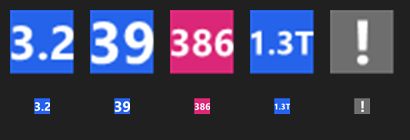

# hostd-traffic-tray

[🇬🇧 English](README.md) · 🇫🇷 Français

**Le trafic [hostd](https://github.com/SiaFoundation/hostd), juste à côté de l'horloge Windows.**

L'interface web de hostd n'affiche la bande passante que pour les journées terminées. Ce petit script
affiche ce que ton hôte Sia a **envoyé** et **reçu**, sous forme de deux icônes près de l'horloge, mises à
jour chaque minute. Par défaut, il compte **la journée en cours** (depuis 00:00, remise à 0 à minuit).
On peut aussi passer aux **24 dernières heures** ou à la **dernière heure**.

*Dans la barre des tâches : 92 GB reçus (rose) et 42 GB envoyés (bleu) depuis minuit.*

| Icône | Signification |
|---|---|
| 🟦 bleue | **Envoyé** (egress : ce que les clients téléchargent) |
| 🟪 rose | **Reçu** (ingress : ce que les clients déposent) |

Mêmes unités que l'interface hostd (GB / TB décimaux). L'icône affiche `3.2`, `39`, `386` (GB), puis `1.3T` (TB).
Passer la souris sur une icône donne la valeur exacte et la période (ex. `Envoyé aujourd'hui : 386.42 GB (14:35)`,
`Envoyé (dernière heure) : 2.31 GB (14:35)`).
Clic droit : **Actualiser**, **Période** (Aujourd'hui (00:00 - 23:59) / 24 dernières heures / Dernière heure),
**Quitter**.
(L'interface est en anglais par défaut : `Sent today`, `Refresh`, `Period`, `Quit`. Voir *Options* pour le français.)
Si hostd ne répond pas, les deux icônes deviennent grises avec un `!`.

## Est-ce sûr ?

C'est un seul petit fichier PowerShell, lisible en quelques minutes : c'est justement la raison de ce dépôt.

- **Lecture seule.** Il appelle uniquement `GET /api/metrics` sur l'API de hostd
  (`http://127.0.0.1:9980` par défaut). Il ne modifie aucun réglage, ne touche jamais au portefeuille et
  n'envoie rien ailleurs.
- **Il n'écrit, ne supprime et ne verrouille aucun fichier.** (Le seul fichier qu'il peut écrire est un
  aperçu des icônes, avec l'option `-TestRender`, qu'il faut lancer exprès.)
- **Aucun accès réseau en dehors de l'API hostd.** Pas de télémétrie, pas de mise à jour automatique,
  pas de téléchargement.
- **Le mot de passe de l'interface hostd** est tapé dans une petite fenêtre masquée au démarrage, gardé
  en mémoire uniquement et **jamais écrit sur le disque**.
- **Aucune installation, aucun droit administrateur**, rien n'est ajouté au démarrage de Windows.
  « Quitter » depuis le menu de l'icône, et il n'en reste rien.
- **Léger pour l'hôte :** 2 petites requêtes à l'API par minute (l'interface hostd en fait bien plus
  quand elle est ouverte).

## Limites connues

Ce sont des compromis généraux, communs à tous les outils de ce type, et pas un comportement caché.
Merci à **[Mike76](https://github.com/mike76-dev)** (auteur de
[sombrero](https://github.com/mike76-dev/sombrero), un serveur SMB pour Sia), qui a relu le code et les a
signalés.

- **Un antivirus peut le bloquer.** Lancer PowerShell depuis un `.bat` avec `-ExecutionPolicy Bypass`,
  c'est aussi ce que font beaucoup de logiciels malveillants : certains antivirus le signalent, quel que
  soit le contenu du script. Si les fichiers disparaissent ou reviennent avec **0 octet** et ne peuvent
  plus être supprimés, ils ont été mis en quarantaine : regarder l'historique de l'antivirus (Windows :
  *Sécurité Windows → Protection contre les virus et menaces → Historique de protection*), puis redémarrer
  pour pouvoir les supprimer. Depuis la v1.1.0, le lanceur est plus simple pour limiter ce risque.
  On peut aussi se passer complètement du `.bat` : voir *Utilisation*, méthode A (clic droit →
  **Exécuter avec PowerShell**).
- **Le mot de passe reste en mémoire pendant que le script tourne.** Pour interroger hostd chaque minute,
  le script garde l'en-tête d'authentification en RAM jusqu'à ce qu'on le quitte. Il n'est jamais écrit
  sur le disque, mais un programme ayant les droits administrateur ou de débogage sur le même PC pourrait
  le lire. Un tel programme pourrait aussi lire la mémoire de hostd lui-même (y compris la graine du
  portefeuille) : le script n'ajoute donc pratiquement aucun risque.
- **L'API de hostd est en HTTP non chiffré.** L'interface hostd est servie en `http://`, donc le mot de
  passe circule en clair. Avec `127.0.0.1` (par défaut), il passe uniquement par la boucle locale et ne
  sort jamais du PC, exactement comme avec le navigateur quand on ouvre l'interface hostd. Si `$Api`
  pointe vers une autre machine ou un conteneur, il circule sur le réseau local.
- **`-ExecutionPolicy Bypass`.** Le `.bat` l'utilise pour que Windows accepte de lancer le script. Cette
  option ne s'applique qu'à ce lancement de PowerShell et ne modifie pas les réglages du système
  (Microsoft précise que la stratégie d'exécution n'est pas une barrière de sécurité). Le script ne se
  met jamais à jour tout seul : relire toute nouvelle version avant de remplacer la sienne.
- **Le script n'est pas signé numériquement.** Un certificat « maison » ne serait reconnu que sur le PC
  de l'auteur, et un certificat public coûte de l'argent chaque année. À la place, le code est court et
  lisible : n'hésitez pas à le relire.
- **Windows Terminal.** Si Windows Terminal est le terminal par défaut, le `.bat` peut laisser une
  fenêtre PowerShell réduite dans la barre des tâches. La laisser : la fermer ferme aussi les icônes.

## Prérequis

- Windows 10 ou 11 (Windows PowerShell 5.1, déjà intégré)
- hostd accessible depuis ce PC, interface sur `http://127.0.0.1:9980` par défaut (voir *Options*)

## Utilisation

1. Télécharger `hostd-traffic-tray.ps1` (et, si on le souhaite, `hostd-traffic-tray.bat`) depuis la
   [dernière release](https://github.com/lolitoun/hostd-traffic-tray/releases/latest) et les mettre
   **dans le même dossier**.
2. Lancer le script, au choix :

   **A. Clic droit (le plus simple, sans le `.bat`) :** clic droit sur `hostd-traffic-tray.ps1` →
   **Exécuter avec PowerShell**.
   - **Windows 11 :** si la ligne n'apparaît pas, cliquer d'abord sur **Afficher d'autres options**
     (ou maintenir **Maj** pendant le clic droit).
   - Si PowerShell demande de modifier la *stratégie d'exécution*, taper `O` (ou `Y` sur un Windows en
     anglais) puis Entrée : cela ne vaut que pour cette fenêtre.
   - Une fenêtre PowerShell reste ouverte : **la réduire, sans la fermer** (la fermer ferme aussi les
     icônes).
   - **Toujours rien dans le menu ?** (Un autre programme, par exemple VS Code ou PowerShell 7, a pris la
     main sur les fichiers `.ps1`.) Ouvrir le menu Démarrer, taper **Windows PowerShell** et l'ouvrir.
     Taper `powershell -ExecutionPolicy Bypass -File ` (avec une espace à la fin), glisser
     `hostd-traffic-tray.ps1` dans la fenêtre pour coller son chemin, puis appuyer sur Entrée.

   **B. Le `.bat` (aucune fenêtre ne reste ouverte) :** double-cliquer sur **`hostd-traffic-tray.bat`**.
   Certains antivirus bloquent les lanceurs `.bat` (voir *Limites connues*) : dans ce cas, utiliser A.
3. Taper le mot de passe de l'interface hostd. Les deux icônes apparaissent près de l'horloge.
4. Clic droit sur une icône → **Période** pour choisir entre aujourd'hui, les 24 dernières heures et la
   dernière heure.

Après un redémarrage : lancer d'abord hostd, puis de nouveau le script.

**Icônes masquées ?** Paramètres → Personnalisation → Barre des tâches → *Autres icônes de barre d'état
système* → activer **Windows PowerShell**.

**Windows bloque le fichier ?** Clic droit sur le `.ps1` téléchargé → Propriétés → cocher **Débloquer** → OK.

## Options

Dans le bloc *Settings*, en haut du script (les commentaires du script sont en anglais) :

- `$Api = 'http://127.0.0.1:9980/api'` : l'API hostd. Changer le port si besoin, ou l'hôte si hostd tourne
  ailleurs (ex. `http://hostd:9980/api` pour un conteneur Docker ; voir *Limites connues* au sujet du HTTP)
- `$Interval = 60000` : intervalle de mise à jour, en millisecondes
- `$Period = 'today'` : période au démarrage, `'today'` (00:00 - 23:59, par défaut), `'24h'` ou `'1h'`
- `$Language = 'en'` : langue de l'interface, `'en'` (anglais, par défaut), `'fr'` (français) ou `'auto'`
  (suit la langue de Windows)

## Comment ça marche

Les statistiques de hostd sont des compteurs cumulés. Le script demande à hostd ses statistiques
**maintenant** et **au début de la période** (`GET /api/metrics?timestamp=...` : minuit heure locale, il y a
24 heures ou il y a 1 heure), puis affiche la différence de `data.rhp.egress` et `data.rhp.ingress`.

Voir [CHANGELOG.md](CHANGELOG.md) pour les changements entre les versions (en anglais).

Sans lien avec la Sia Foundation. Licence MIT.
