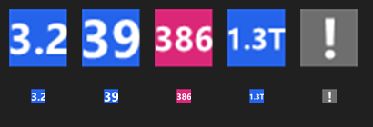

# hostd-traffic-tray

🇬🇧 English · [🇫🇷 Français](README.fr.md)

**Your [hostd](https://github.com/SiaFoundation/hostd) traffic, right next to your Windows clock.**

The hostd web UI only shows bandwidth for finished days. This small script shows what your Sia host has
**sent** and **received**, as two tray icons that refresh every minute. By default it counts **today**
(from 00:00, back to 0 at midnight). You can also switch to the **last 24 hours** or the **last hour**.

*In the taskbar: 92 GB received (pink) and 42 GB sent (blue) since midnight.*

| Icon | Meaning |
|---|---|
| 🟦 blue | **Sent** (egress: data downloaded by renters) |
| 🟪 pink | **Received** (ingress: data uploaded by renters) |

Same units as the hostd UI (decimal GB / TB). The icon shows `3.2`, `39`, `386` (GB), then `1.3T` (TB).
Hover an icon for the exact value and period (e.g. `Sent today : 386.42 GB (14:35)`,
`Sent (last hour) : 2.31 GB (14:35)`).
Right-click: **Refresh**, **Period** (Today (00:00 - 23:59) / Last 24 hours / Last hour), **Quit**.
If hostd can't be reached, both icons turn grey with `!`.

## Is it safe?

It's one short PowerShell file you can read in a few minutes, and that's the point of this repository.

- **Read-only.** It only calls `GET /api/metrics` on your hostd API (`http://127.0.0.1:9980` by default).
  It never changes a setting, never touches your wallet, never sends anything elsewhere.
- **It never writes, deletes or locks any file.** (The only file it can write is an optional icon preview,
  with the `-TestRender` switch, which you have to run on purpose.)
- **No network access beyond your hostd API.** No telemetry, no updates, no downloads.
- **Your hostd UI password** is typed in a small masked window at startup, kept in memory only,
  and **never written to disk**.
- **No install, no admin rights**, nothing added to Windows startup. Quit from the icon menu and it's gone.
- **Light on the host:** 2 small API calls per minute (the hostd UI itself does much more when open).

## Known limitations

These are general trade-offs of any tool of this kind, not hidden behavior. Thanks to
**[Mike76](https://github.com/mike76-dev)** (author of [sombrero](https://github.com/mike76-dev/sombrero),
an SMB server for Sia), who reviewed the code and pointed them out.

- **Antivirus software may block it.** Starting PowerShell from a `.bat` with `-ExecutionPolicy Bypass`
  is also what a lot of malware does, so some antivirus products flag it whatever the script contains.
  If the files vanish or come back with **0 bytes** and can't be deleted, they were quarantined: check
  your antivirus history (Windows: *Windows Security → Virus & threat protection → Protection history*),
  then reboot to delete them. Since v1.1.0 the launcher is plainer to make this less likely.
  You can also skip the `.bat` entirely: see *Usage*, method A (right-click → **Run with PowerShell**).
- **The password stays in memory while the script runs.** To query hostd every minute, the script keeps
  the Basic Auth header in RAM until you quit. It is never written to disk, but a process with
  administrator or debugging rights on the same PC could read it. Such a process could also read hostd's
  own memory (including your wallet seed), so the script adds practically no extra risk.
- **hostd's API is plain HTTP.** hostd's UI is served over `http://`, so the password is sent
  unencrypted. With the default `127.0.0.1` it only goes over the loopback interface and never leaves your
  PC, exactly like your browser when you open the hostd UI. If you point `$Api` to another machine or a
  container, it travels over your local network.
- **`-ExecutionPolicy Bypass`.** The `.bat` uses it so Windows lets the script run. It applies only to
  that one PowerShell process and does not change your system settings (Microsoft notes the execution
  policy is not a security boundary). The script never updates itself: read any new version before
  replacing the one you have.
- **The script is not code-signed.** A self-signed certificate would only be trusted on the author's PC,
  and a public one costs money every year. The code is short and readable instead: please review it.
- **Windows Terminal.** If Windows Terminal is your default terminal, the `.bat` may leave a minimized
  PowerShell window in the taskbar. Leave it there: closing it also closes the icons.

## Requirements

- Windows 10 or 11 (Windows PowerShell 5.1, built in)
- hostd reachable from this PC, UI on `http://127.0.0.1:9980` by default (see *Options*)

## Usage

1. Download `hostd-traffic-tray.ps1` (and, if you want it, `hostd-traffic-tray.bat`) from the
   [latest release](https://github.com/lolitoun/hostd-traffic-tray/releases/latest) and put them
   **in the same folder**.
2. Start the script, in one of these two ways:

   **A. Right-click (simplest, no `.bat` needed):** right-click `hostd-traffic-tray.ps1` →
   **Run with PowerShell**.
   - **Windows 11:** if you don't see it, click **Show more options** first
     (or hold **Shift** while you right-click).
   - If PowerShell asks about changing the *execution policy*, type `Y` then Enter: it only applies to
     that window.
   - A PowerShell window stays open: **minimize it, don't close it** (closing it closes the icons).
   - **Still not in the menu?** (Another app, e.g. VS Code or PowerShell 7, took over `.ps1` files.)
     Open the Start menu, type **Windows PowerShell** and open it. Type
     `powershell -ExecutionPolicy Bypass -File ` (with a space at the end), drag
     `hostd-traffic-tray.ps1` into the window to paste its path, then press Enter.

   **B. The `.bat` (no window left open):** double-click **`hostd-traffic-tray.bat`**.
   Some antivirus products flag `.bat` launchers (see *Known limitations*): if yours does, use A.
3. Enter your hostd UI password. The two icons appear next to the clock.
4. Right-click an icon → **Period** to switch between today, the last 24 hours and the last hour.

After a reboot, start hostd first, then the script again.

**Icons hidden?** Settings → Personalization → Taskbar → *Other system tray icons* → turn on **Windows PowerShell**.

**Windows blocks the file?** Right-click the downloaded `.ps1` → Properties → tick **Unblock** → OK.

## Options

In the *Settings* block at the top of the script:

- `$Api = 'http://127.0.0.1:9980/api'`: your hostd API. Change the port if needed, or the host if hostd runs
  elsewhere (e.g. `http://hostd:9980/api` for a Docker container; see *Known limitations* about HTTP)
- `$Interval = 60000`: refresh interval in milliseconds
- `$Period = 'today'`: period at startup, `'today'` (00:00 - 23:59, default), `'24h'` or `'1h'`
- `$Language = 'en'`: interface language, `'en'` (default), `'fr'` (French) or `'auto'` (follow Windows)

## How it works

hostd's metrics are cumulative counters. The script asks hostd for its metrics **now** and **at the start of
the period** (`GET /api/metrics?timestamp=...`: local midnight, 24 hours ago or 1 hour ago), and shows the
difference of `data.rhp.egress` and `data.rhp.ingress`.

See [CHANGELOG.md](CHANGELOG.md) for what changed between versions.

Not affiliated with the Sia Foundation. MIT licensed.
